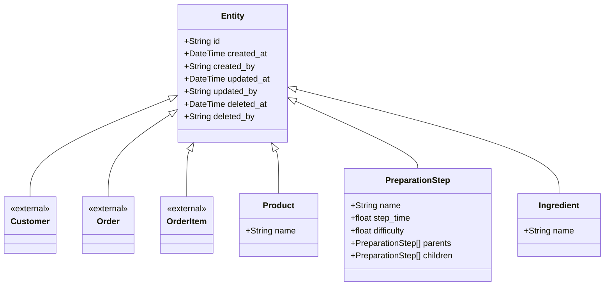

# Entities



## Entity

Shared base for every **entity** in the domain: identity plus audit trail

### Design notes

- `id` defaults to a `uuid4` when not supplied, so entities are identifiable
  before they ever reach a service or store.

## Ingredient

A raw material consumed while preparing a product. An ingredient knows *what it
is

## Product

What the customer buys — the menu item. A product knows which steps produce it;
it does not know anything about stock, and it does not carry a difficulty of its
own — difficulty belongs to the individual steps.

### Design notes

**Product is not Ingredient.** A product is *sold*; an ingredient is *consumed*.
Nothing stocks a product and nothing orders an ingredient. They look similar
because both carry `id` and `name`, but merging them would leave
`PreparationStep[]` meaningless on a tomato, and `quantity_in_stock` meaningless
on a hamburger.

## PreparationStep

One step in the recipe for a product ("toast the bread"), with the time it takes
at baseline and how demanding it is. Steps are what make requirement 9d real:
the simulator must actually wait for each one.

A step also carries the shape of the recipe: `parents` are the steps that must
finish before it can start, `children` are the steps it unblocks. Together they
make a recipe a graph rather than a list, which is what lets the simulator tell
apart the steps that may overlap from the ones that must wait.

### Design notes

`difficulty` feeds the preparation-time formula of requirement 10:

```
step_duration = step.step_time / chef.experience * step.difficulty
```

It is stored per step rather than on the product because two steps in the same
dish are not equally demanding — searing a patty and plating a bun ask different
things of a chef, and one number on the product cannot express that. `step_time`
remains the baseline duration; `difficulty` scales it.

Linking, cycle detection and traversal are deliberately absent. The step is
plain data; the component that builds and walks the graph arrives with the
business logic.
